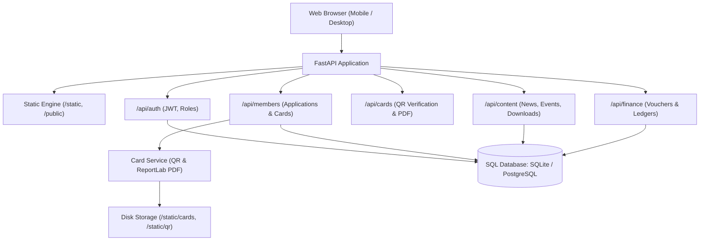

# Architecture Documentation
## Misri Khel Qaumi Ittehad — Digital Community Platform & Management System

### 1. Overview
The **Misri Khel Qaumi Ittehad Foundation (مصری خیل قومی اتحاد فاؤنڈیشن)** platform is designed as an institutional digital community hub, membership verification engine, and secretariat workspace. It bridges Pakistani diaspora communities living in metropolitan centers (Karachi, Rawalpindi/Islamabad) with their ancestral origins in Khyber Pakhtunkhwa (Shangla, Torghar, Buner, Swat).

### 2. Design System Inspiration & Logo Integration
- **Inspiration Source:** Bantva Memon Jamat portal (`https://bmjr.net/` and `https://bmjr.net/memon-samaj/`).
- **Visual Identity:**
  - Official Misri Khel Logo emblem preserved without distortion, featuring mountain peaks, pine forests, mutual handshake of unity, crescent & star, and wheat laurels.
  - **Motto:** اتحاد • خدمت • عزت • ترقی (Unity • Service • Honor • Progress).
  - **Color Palette:**
    - Deep Forest / Emerald Green (`#0D472B`, `#0F5132`, `#145A32`)
    - Imperial Gold & Amber Accents (`#D4AF37`, `#B8860B`, `#F59E0B`)
    - Crisp White & Warm Porcelain Cards (`#FFFFFF`, `#F8FAF9`, `#F0F5FA`)
    - Dark Navy & Charcoal Slate Typography (`#111C55`, `#1A202C`, `#64748B`)
  - **Typography:**
    - Urdu: `Noto Nastaliq Urdu`, `Jameel Noori Nastaleeq` fallback
    - Pashto: `Noto Sans Arabic` with proper Pashto glyph support
    - English: `Urbanist`, `Outfit`, sans-serif
  - **RTL / LTR System:** Native bidirectional rendering with instant client-side switching.

### 3. Technology Stack
- **Backend:**
  - Python 3.14+
  - FastAPI (High performance, async-ready web framework)
  - SQLAlchemy 2.0 (Relational ORM)
  - Pydantic v2 (Input schema validation & data serialization)
  - JWT (`PyJWT` / `python-jose`) for secure administrative session management
  - `bcrypt` for secure salted password hashing
  - `qrcode` & `Pillow` for cryptographic QR token generation
  - `reportlab` for automated high-resolution digital membership card PDF generation
- **Frontend:**
  - Modern component-based HTML5, CSS3, and JavaScript
  - Zero external bloatware or heavy node runtime dependencies for public pages
  - Dynamic client-side language switching (`ur`, `ps`, `en`)
  - Mobile-responsive navigation and touch-friendly controls
- **Database:**
  - SQLite for rapid local prototyping and test suites
  - Production-ready PostgreSQL architecture via SQLAlchemy connection strings

### 4. Component Hierarchy

