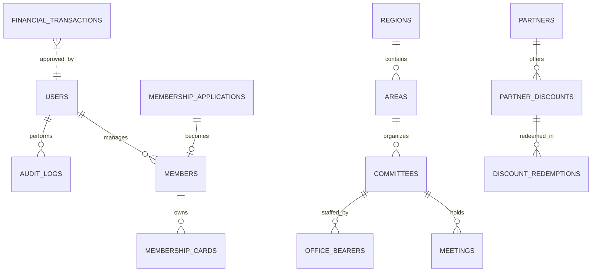

# Database Schema & Data Dictionary
## Misri Khel Qaumi Ittehad System

### Relational Entity Model

### Core Tables

#### 1. `users`
- `id` (Integer, PK)
- `username` (VARCHAR(50), Unique)
- `email` (VARCHAR(100), Unique, Nullable)
- `full_name_ur` (VARCHAR(100))
- `full_name_en` (VARCHAR(100))
- `hashed_password` (VARCHAR(255))
- `role` (ENUM: SUPER_ADMIN, CENTRAL_ADMIN, GENERAL_SECRETARY, REGIONAL_ADMIN, etc.)
- `assigned_region` (VARCHAR(100), Nullable - supports regional isolation)
- `is_active` (Boolean)

#### 2. `membership_applications`
- `id` (Integer, PK)
- `application_number` (VARCHAR(50), Unique, e.g. `APP-2026-0001`)
- `full_name_ur`, `full_name_en`
- `father_name_ur`, `father_name_en`
- `mobile_number` (VARCHAR(20), Indexed)
- `current_city`, `current_area`
- `ancestral_region`, `ancestral_village`
- `occupation`, `professional_category`
- `status` (ENUM: DRAFT, PENDING, UNDER_REVIEW, APPROVED, REJECTED, SUSPENDED, INACTIVE)
- `review_notes` (Text)
- `reviewed_by` (VARCHAR(100))
- `reviewed_at` (DateTime)

#### 3. `members`
- `id` (Integer, PK)
- `membership_id` (VARCHAR(50), Unique, e.g. `MKQI-2026-0001`)
- `application_id` (FK -> `membership_applications.id`)
- `status` (ENUM)
- `joined_date` (DateTime)

#### 4. `membership_cards`
- `id` (Integer, PK)
- `card_number` (VARCHAR(50), Unique, e.g. `CRD-2026-0001`)
- `member_id` (FK -> `members.id`)
- `verification_token` (VARCHAR(100), Unique, UUID)
- `status` (ENUM: ACTIVE, SUSPENDED, REVOKED, EXPIRED)
- `qr_code_path`, `pdf_path` (File storage references)

#### 5. `audit_logs`
- `id` (Integer, PK)
- `actor_username`
- `action` (e.g. APPROVE_APPLICATION, ISSUE_CARD)
- `target_entity`
- `target_id`
- `details`
- `created_at`
